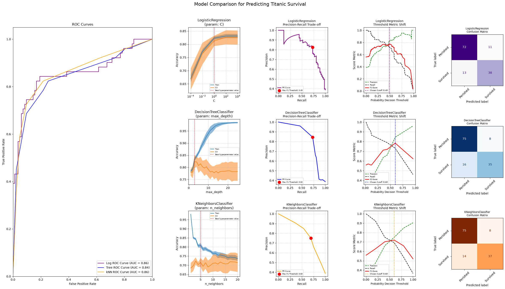
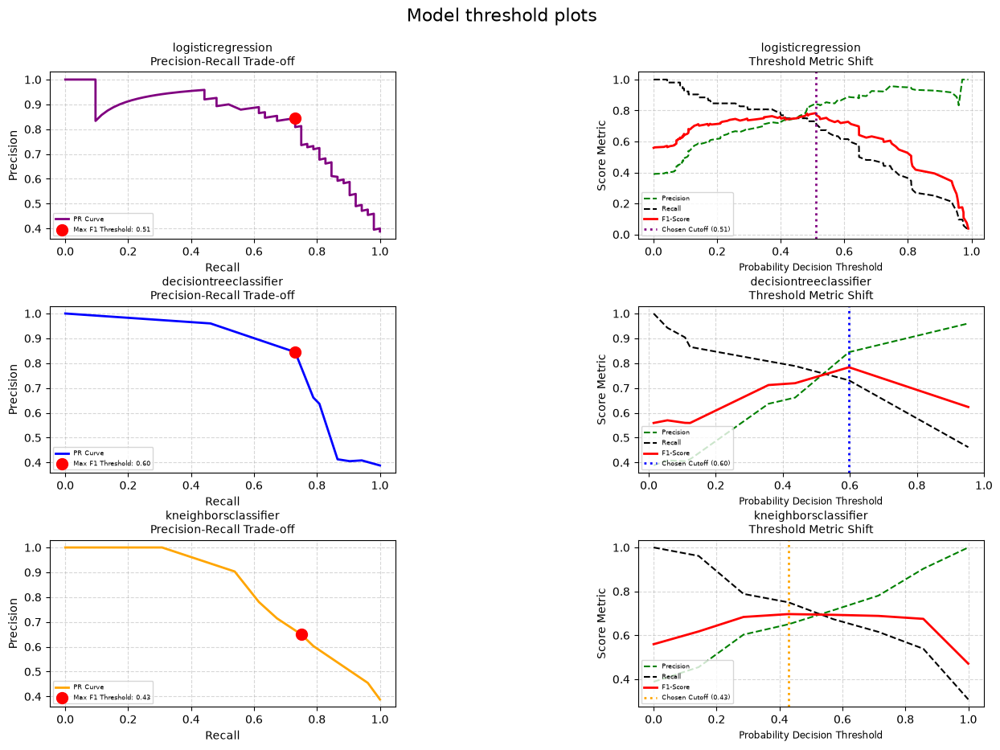

# Titanic Survival Prediction

Predicting which Titanic passengers survived using three classic classifiers (logistic regression, a decision tree, and k-nearest neighbors), built with a leakage-safe scikit-learn `Pipeline` workflow. The project covers feature engineering, hyperparameter tuning with cross-validation, decision-threshold tuning, and a full set of diagnostics: validation curves, learning curves, ROC curves, confusion matrices, and precision-recall analysis.

## Results

All numbers below are on a **held-out test set of 134 passengers** that was never used for tuning or threshold selection. Each model's decision threshold was chosen on a separate validation set to maximize F1.

| Model | Best hyperparameter | Threshold | Test ROC AUC | Accuracy | Precision | Recall | F1 |
|---|---|---|---|---|---|---|---|
| Logistic Regression | C = 10 | 0.51 | 0.86 | 0.84 | 0.82 | 0.73 | 0.77 |
| Decision Tree | max_depth = 3 | 0.60 | 0.84 | 0.82 | 0.81 | 0.69 | 0.74 |
| kNN | n_neighbors = 7 | 0.43 | 0.87 | 0.81 | 0.73 | 0.78 | 0.75 |

For reference, always predicting "perished" would score about 62% accuracy on this test set. Five-fold cross-validation ROC AUC on the training and validation data is around 0.87 for all three models.

### What the diagnostics show

- **The three models are close.** Test AUC ranges from 0.84 to 0.87. With only 134 test passengers, a single accuracy figure carries roughly a ±6 percentage point margin of error, so these differences are within noise and I don't claim a clear winner. Logistic regression has the best accuracy and F1, while kNN has the highest recall (it catches more survivors but raises more false alarms).
- **The decision tree overfits quickly.** Training AUC climbs toward 1.0 as depth increases, while cross-validated AUC peaks at depth 3 and falls to about 0.77 beyond depth 10.
- **Logistic regression is stable.** Its training and cross-validation curves converge near 0.87 to 0.88, and CV performance is flat for C of roughly 0.1 and above, so regularization strength barely matters. More data is unlikely to help much as seen in the learning curve plot.
- **kNN keeps a train/CV gap.** Its cross-validation score is still slowly rising as training size grows, so it is the model most likely to benefit from more data.

### Threshold analysis

Predicted probabilities become survive/perish predictions through a cutoff. For each model I picked the cutoff that maximizes F1 on the validation set, which gave 0.51 (logistic regression), 0.60 (tree), and 0.43 (kNN). The precision-recall curves and the precision/recall/F1-versus-threshold plots above show the tradeoff: raising the cutoff increases precision and lowers recall, and vice versa.

## Approach

**1. Feature engineering**
- Extracted a passenger title (Mr, Mrs, Miss, Master, Rare) from the `Name` column and grouped uncommon titles into `Rare`.
- Dropped `Ticket` and `Cabin` (Cabin is mostly missing, and Ticket has little usable signal).
- Final features: `Pclass`, `Sex`, `Age`, `SibSp`, `Parch`, `Fare`, `Embarked`, `Title`.

**2. Data splitting**
- Stratified 70% train / 15% validation / 15% test split so the survival rate is preserved in each part.
- Validation set: used only to choose each model's decision threshold.
- Test set: used once, at the end.

**3. Preprocessing inside a Pipeline**
- Numeric columns (`Age`, `SibSp`, `Parch`, `Fare`): median imputation, then standard scaling.
- Categorical columns (`Embarked`, `Pclass`, `Sex`, `Title`): most-frequent imputation, then one-hot encoding (unseen categories are ignored rather than raising an error).
- Everything is wrapped in a `ColumnTransformer` and attached to each model with `Pipeline`, so imputing, scaling, and encoding are re-fit on training data only, inside every cross-validation fold.

**4. Hyperparameter tuning**
- `GridSearchCV` with 5-fold cross-validation, scored by ROC AUC, run on the raw training data through the full pipeline.
- Tuned: `C` (logistic regression), `max_depth` (decision tree), `n_neighbors` (kNN).

**5. Threshold selection and evaluation**
- Predicted probabilities on the validation set, then picked the cutoff that maximizes F1 from the precision-recall curve.
- Evaluated each tuned model on the test set with ROC curves, confusion matrices, and the metrics above.

## What I learned

My first version scaled and imputed the data before splitting and ran cross-validation and the diagnostic curves on unscaled data, which quietly leaked information from validation rows into training and evaluated a different model than the one I tuned. Moving all preprocessing into a scikit-learn `Pipeline` fixed both problems at once: the pipeline refits every preprocessing step inside each fold and carries the scaler along into the validation and learning curves. Other takeaways:

- Tune on a probability-based metric (ROC AUC), then choose the decision threshold separately so the two steps don't optimize conflicting objectives.
- Validation curves and learning curves are the fastest way to tell overfitting (decision tree) from stable models (logistic regression).

## Limitations

- The test set is small (134 rows), so metrics have wide uncertainty.
- Thresholds were tuned on a validation set of similar size, so they are noisy, especially for the decision tree.
- Cross-validation scores on the training and validation data are slightly optimistic, because hyperparameters were tuned on part of that data. The test-set numbers are the unbiased estimate.
